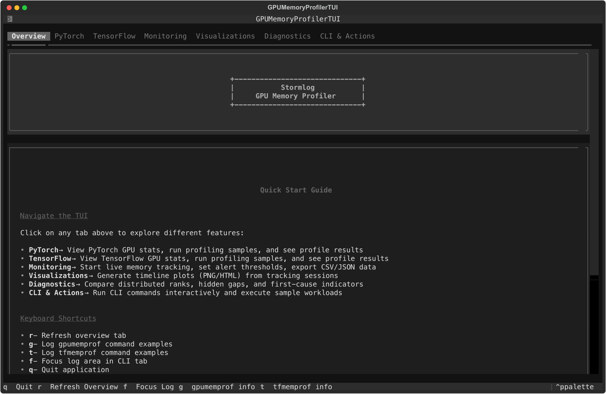
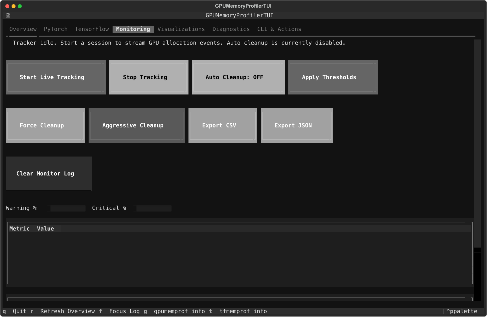
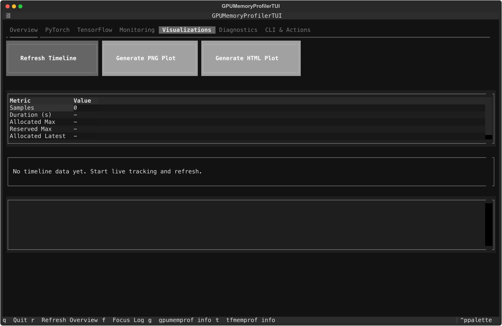
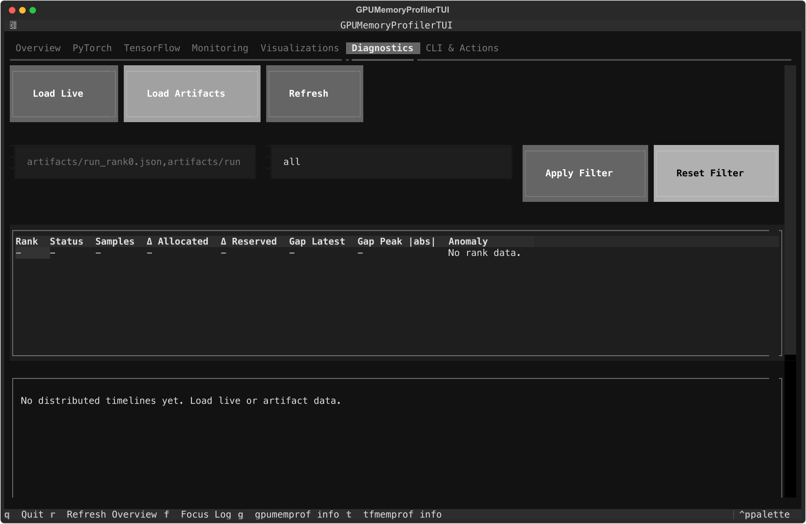
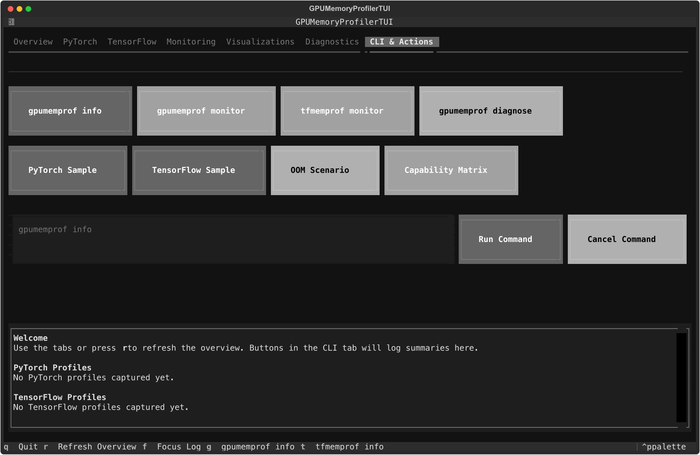

# Terminal UI Guide

Stormlog ships a Textual TUI for teams that want to move between live monitoring, exported artifacts, and command execution without leaving the terminal.

## Install and launch

```bash
pip install "stormlog[tui,torch]"
stormlog
```

Running `stormlog` with no arguments still launches the TUI. The explicit
`stormlog tui` form is also available when you want to distinguish the TUI from
other top-level command groups such as `stormlog infer`.

If you are working from a source checkout, reinstall with the TUI dependencies so the current app startup requirements are present:

```bash
pip install -e ".[tui,torch]"
```

For MLX, install `stormlog[mlx,tui]` and launch `stormlog tui --framework mlx`.
Offline MLX artifact browsing needs only `stormlog[tui]` and initializes no
framework. The default selection remains PyTorch.

## Current tabs

The current TUI surface contains eight tabs:

- `Overview`
- `PyTorch`
- `TensorFlow`
- `MLX`
- `Monitoring`
- `Visualizations`
- `Diagnostics`
- `CLI & Actions`

## What each tab is for

### Overview

- shows the platform, Python, GPU and TensorFlow device details
- lists the first commands to run and what each tab is for
- lists the keyboard shortcuts
- points to `stormlog infer` for inference profiling, which runs from the shell
- is the fastest place to confirm that the app launched with the expected environment



### PyTorch

- shows each device's current, peak and reserved memory
- lists the profiles recorded in this process, including the PyTorch sample
  run from `CLI & Actions`
- refreshes or clears those profiles

If CUDA is unavailable, the sample workload falls back to the CPU profiler path when possible.


### TensorFlow

- shows TensorFlow environment and device details
- lists the TensorFlow profiles recorded in this process, including the
  TensorFlow sample run from `CLI & Actions`
- refreshes or clears those profiles

### MLX

Explicit Runtime Info and Sample actions initialize MLX only when requested.
The sample evaluates a modest matrix result and shows sampled peak, active delta,
synchronized host time, and completion verification. Load Artifact accepts saved
profile JSON, tracker JSON, JSONL, telemetry sinks and capture bundles without a
native runtime. Nullable timeline values remain gaps.

Use MLX for Tracking selects the MLX adapter in Monitoring. It observes this
TUI process, with distinct active allocator, reusable cache, RSS, health and
native lifetime peak labels. GPU percentages, fragmentation and cleanup controls
are unavailable. Capture external workloads with `mlxmemprof run` and load their
artifacts instead. See the [MLX guide](mlx_testing_guide.md).


### Monitoring

- starts or stops a live tracker session
- shows rolling memory stats
- exports current tracker events to `./exports`
- lets you tune the `Warning %` and `Critical %` thresholds (80 and 95 by
  default) when using the GPU tracker
- exposes watchdog controls for supported GPU environments



Use this tab when you want the data that later feeds the Visualizations or Diagnostics tabs.

Start Live Tracking loads the default tracker dependencies on first use. It
tries the GPU tracker and falls back to the CPU tracker when PyTorch or GPU
tracking is unavailable. Browsing saved MLX artifacts does not load those
dependencies.

### Visualizations

- renders an ASCII timeline from the active tracker session
- writes PNG plots to `./visualizations`
- writes HTML plots to `./visualizations`



The export buttons only work after timeline samples exist. If you have not started tracking yet, the tab will report that no timeline data is available.

### Diagnostics

- loads live telemetry from the active tracker session
- loads artifacts from JSON, CSV, or diagnose directories
- discovers and lists distinct artifact sessions instead of merging them silently
- lets you target a specific session id after loading artifacts
- rebuilds rank-level diagnostics
- supports rank filters such as `all`, `0,2,4-7`
- highlights anomaly indicators and focused rank timelines
- compares the focused rank with the other ranks and ranks the fields that
  differ most (`Compare Rank`)
- surfaces phase paths for first anomalies and earliest indicators when phase telemetry is present



The `Artifacts` field accepts comma-separated paths. Use `Load Artifacts`
first, then `Refresh` after changing the path set. When multiple sessions are
found, the Diagnostics tab defaults to the newest `completed` session and lets
you switch to another one by entering its id in `Session` and applying it.
Filter ranks in `Ranks`.

If the loaded telemetry contains `phase_enter` / `phase_exit` records, the
indicator table's Phase column shows each indicator's resolved phase path,
for example `epoch 1 / train`, and rank rows carry it in the Diagnostics model.

When the product is choosing a useful winner from an otherwise ambiguous phase
set, the TUI surfaces that with a `(likely)` marker instead of flattening it
into an exact attribution.

That marker is presentation-only. The underlying diagnostics model still keeps
the canonical phase attribution separate from any heuristic winner.

### CLI & Actions

- runs common `gpumemprof` and `tfmemprof` commands
- runs sample workloads
- runs the OOM scenario helper
- runs the capability matrix smoke path
- lets you enter any shell command in the `Command` field of the inline runner



Use this tab when you want to kick off a CLI flow and keep the output attached to the same TUI session.

## Daily workflows

### Workflow: capture and export a live session

1. Open `Monitoring`.
2. Click `Start Live Tracking`.
3. Let the workload run long enough to collect samples.
4. Use `Export CSV` or `Export JSON` if you want the raw event stream.
5. Move to `Visualizations` and click `Refresh Timeline`.
6. Export PNG or HTML if you want a shareable plot.

### Workflow: investigate a saved artifact

1. Open `Diagnostics`.
2. Enter one or more artifact paths.
3. Click `Load Artifacts`.
4. If multiple sessions were discovered, optionally enter a session id and apply it.
5. Click `Refresh`.
6. Narrow the result set with the rank filter if needed.
7. Select a rank from the table to focus the timeline.
8. Click `Compare Rank` to see which fields set that rank apart from the
   others; see [Outlier Comparison](outlier_comparison.md).

### Workflow: run the release smoke path from the UI

1. Open `CLI & Actions`.
2. Click `Capability Matrix`.
3. Review the inline log output.
4. If you need more detail, rerun the same command in a normal shell and archive the artifacts.

The screenshots on this page come from the shipped TUI on an NVIDIA L4 while
ResNet-18 trained on CIFAR-10 for six epochs in the same process, each epoch's
training and evaluation marked as tracker phases, except the MLX tab, which
was taken on Apple Silicon. `examples/scenarios/tui_screenshots.py` takes them
on any machine, and `examples/scenarios/modal_readme_media.py` reruns the L4
capture on Modal.

For incident playbooks and rank-aware operational workflows that start in the
TUI Diagnostics tab, use
[Distributed Diagnostics Recipes](cookbook/distributed.md) and
[Incident Playbooks](cookbook/incidents.md).

## Keyboard shortcuts

| Key | Action |
| --- | --- |
| `r` | Refresh overview |
| `f` | Focus the CLI log |
| `g` | Log `gpumemprof info` hints |
| `t` | Log `tfmemprof info` hints |
| `q` | Quit the TUI |

## Troubleshooting

### `stormlog` is missing

Install the TUI extra:

```bash
pip install "stormlog[tui,torch]"
```

### `Capability Matrix` or `OOM Scenario` fails with `ModuleNotFoundError`

Those quick actions run source-only `examples.*` modules. If you installed from
PyPI, use the inline command runner with the equivalent CLI-safe flow instead:

```bash
gpumemprof info
gpumemprof track --duration 10 --interval 0.5 --output track.json --format json
gpumemprof diagnose --duration 0 --output ./diag
```

For full button coverage, use a source checkout with:

```bash
pip install -e ".[tui,torch]"
```

### PNG or HTML export fails

- install `stormlog[viz]`
- make sure you already have live timeline samples

### Diagnostics shows no data

- load live telemetry after starting a tracker session, or
- load actual JSON, CSV, or diagnose artifact paths before refreshing

### The app launched but the window looks empty

Increase the terminal size. The deterministic tests use roughly `140x44`, and smaller sizes will compress the layout significantly.
